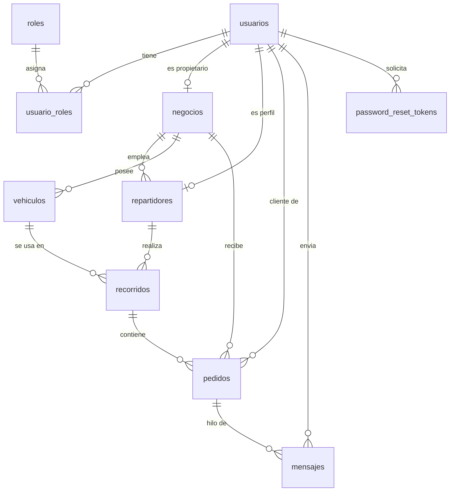

# 01 · BASE DE DATOS

MySQL 8 · Flyway · script real en `backend/src/main/resources/db/migration/V1__esquema.sql` (es la fuente de verdad; si este documento y el SQL difieren, manda el SQL).
Cualquier cambio posterior va en un nuevo archivo `V2__...sql`, nunca editando V1 una vez desplegado.

## Diagrama entidad-relación

Tablas sueltas: `tokens_revocados` (logout), `notificaciones_log` (auditoría de envíos).

## Tablas
| Tabla | Para qué sirve | Relaciones clave |
|---|---|---|
| `roles` | ADMIN, NEGOCIO, REPARTIDOR, CLIENTE | |
| `usuarios` | cuentas (email único, `password_hash` BCrypt, `activo`) | |
| `usuario_roles` | **N:M** usuarios–roles | PK compuesta |
| `negocios` | un negocio por usuario NEGOCIO | `propietario_id` único → usuarios |
| `repartidores` | perfil del repartidor; `negocio_id` null = independiente | `usuario_id` único, `negocio_id` → negocios |
| `vehiculos` | flota del negocio; estado ACTIVO o MANTENIMIENTO ("en uso hoy" se calcula con recorridos) | `negocio_id` → negocios |
| `recorridos` | ruta de un repartidor en una fecha (único por repartidor y fecha) | `repartidor_id`, `vehiculo_id` (null para independiente) |
| `pedidos` | entrega; paradas = pedidos con `recorrido_id` ordenados por `orden_parada` | `negocio_id` (null si ABIERTO), `cliente_id` (null si no tiene cuenta), `recorrido_id` |
| `mensajes` | mensajes ligados a un pedido | `pedido_id`, `remitente_id`, `destinatario_id` |
| `tokens_revocados` | `jti` de tokens JWT cerrados con logout | |
| `password_reset_tokens` | tokens de recuperación (se guarda el hash, vence en 30 min) | `usuario_id` |
| `notificaciones_log` | cada correo/SMS/WhatsApp enviado o fallido | |

Es 12 tablas, cumple el mínimo de 5 y la relación N:M.

## Valores permitidos
- `vehiculos.tipo`: COMBI, MOTOCICLETA, CAMIONETA, BICICLETA, AUTOMOVIL · `vehiculos.estado`: ACTIVO, MANTENIMIENTO
- `recorridos.estado`: PLANEADO, EN_CURSO, FINALIZADO
- `pedidos.modalidad`: NEGOCIO, ABIERTO · `pedidos.estado`: PENDIENTE, ASIGNADO, EN_CAMINO, ENTREGADO, NO_ENTREGADO
- `notificaciones_log.canal`: EMAIL, SMS, WHATSAPP · `estado`: ENVIADO, FALLIDO

En Java son `enum` con `@Enumerated(EnumType.STRING)` (las columnas son VARCHAR con CHECK, no ENUM de MySQL).

## Zonas de entrega (datos de referencia, constante en código)
| Zona | Lat | Lng |
|---|---|---|
| Centro Histórico | 17.0609 | -96.7253 |
| Jalatlaco | 17.0663 | -96.7176 |
| Colonia Reforma | 17.0745 | -96.7160 |
| Xochimilco | 17.0720 | -96.7270 |
| Colonia América | 17.0700 | -96.7300 |
| Colonia Volcanes | 17.0835 | -96.7100 |
| Cinco Señores | 17.0415 | -96.7081 |
| Santa Lucía del Camino | 17.0707 | -96.6906 |
| Santa Cruz Xoxocotlán | 17.0242 | -96.7370 |
| San Felipe del Agua | 17.1020 | -96.7180 |

## Datos de prueba (los carga `DataSeeder`, un `CommandLineRunner`)
Solo se ejecuta si `roles` está vacía. Las contraseñas se cifran con el `PasswordEncoder` (por eso no van en SQL).

**Contraseña de todos los usuarios demo: `Ruta#2026`. La del administrador: `Admin#2026`.**

| # | Nombre | Email | Rol | Notas |
|---|---|---|---|---|
| 1 | Administrador RutaOax | admin@rutaoax.com | ADMIN | credencial fija documentada en el README |
| 2 | Marta Valle | negocio1@rutaoax.com | NEGOCIO | negocio "Dulces del Valle" |
| 3 | Héctor Mora | negocio2@rutaoax.com | NEGOCIO | negocio "Panadería La Espiga" |
| 4 | Luis Martínez | repartidor1@rutaoax.com | REPARTIDOR | empresa: Dulces del Valle |
| 5 | Ana Ruiz | repartidor2@rutaoax.com | REPARTIDOR | empresa: Dulces del Valle |
| 6 | Jorge Pérez | repartidor3@rutaoax.com | REPARTIDOR | empresa: Dulces del Valle, sin recorrido hoy |
| 7 | Rosa Cruz | repartidor4@rutaoax.com | REPARTIDOR | empresa: La Espiga |
| 8 | Pablo Hernández | independiente1@rutaoax.com | REPARTIDOR | independiente |
| 9 | Iván Torres | independiente2@rutaoax.com | REPARTIDOR | independiente |
| 10 | Carla Ríos | cliente1@rutaoax.com | CLIENTE | |
| 11 | Mario Cruz | cliente2@rutaoax.com | CLIENTE | |
| 12 | Elena Gómez | cliente3@rutaoax.com | CLIENTE | |
| 13 | Raúl Silva | cliente4@rutaoax.com | CLIENTE | |

Cantidades mínimas (rúbrica: 10 a 15 por tabla principal): **usuarios 13 · vehículos 10** (6 del negocio 1, 4 del negocio 2, con un seguro por vencer en 5 días) **· pedidos 15** (mezcla de los 5 estados y de ambas modalidades; 4 ABIERTO sin tomar) **· recorridos 6** (fecha de hoy y de días cercanos) **· mensajes 10** (ligados a pedidos con cliente_id).
Los teléfonos demo son de 10 dígitos (`951555XXXX`). Antes de la demo, cambia el teléfono de `cliente1` por tu número real para recibir SMS y WhatsApp.

## Respaldo
Para la entrega: `mysqldump -u rutaoax_app -p rutaoax > rutaoax_backup.sql` y guardar en `database/rutaoax_backup.sql` del repo.
