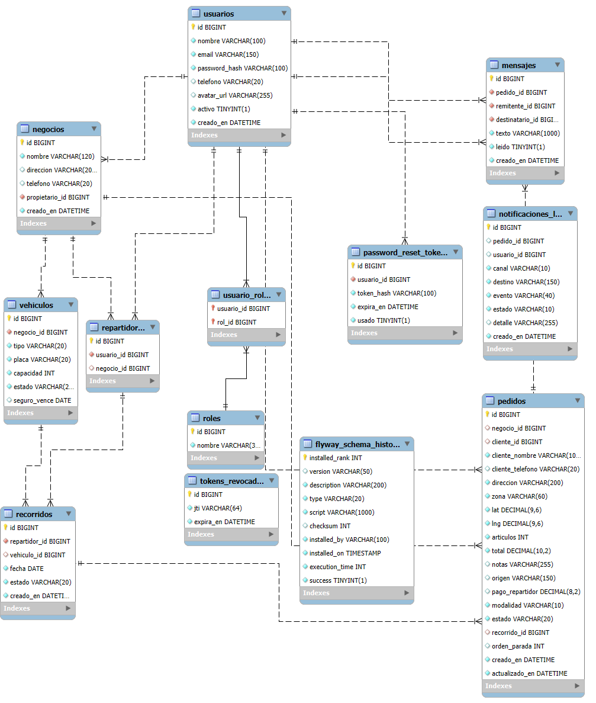
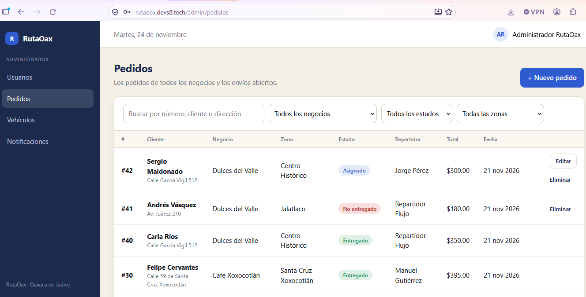
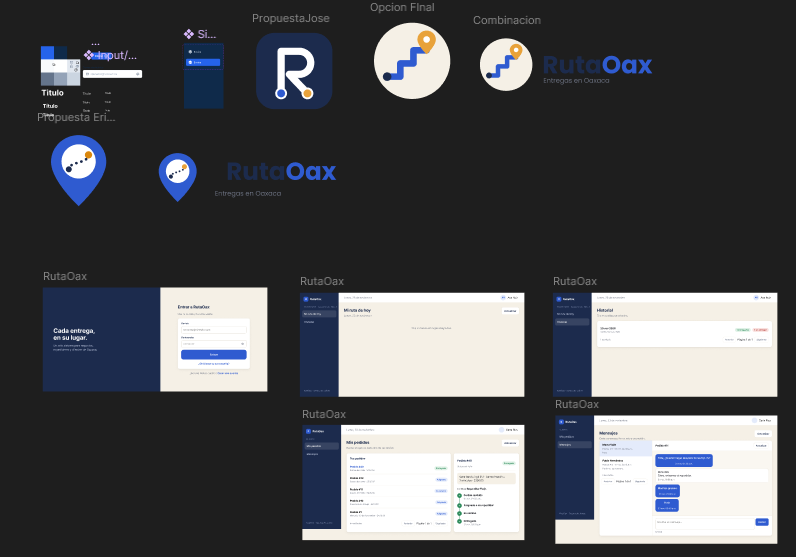
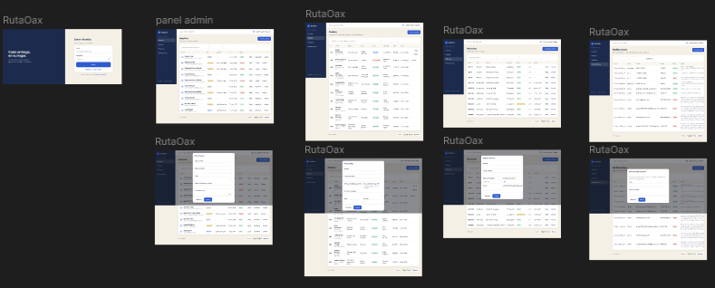
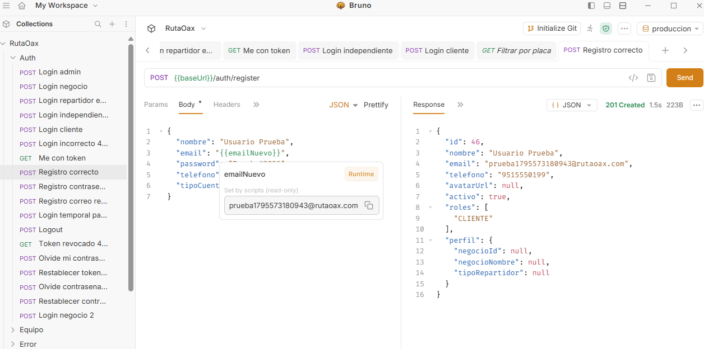

desarrolladores 
Jose Jose Osvaldo
Santiago Ramire Erick Omar


links
proyecto desplegado
```https://rutaoax.devs8.tech/login```

repositorio 
``` https://github.com/JoseJose7520-dev/RutaOax ```

``` https://github.com/users/JoseJose7520-dev/projects/4 ```

figma
``` https://www.figma.com/design/K1VaaQSKUMMfZGb8G0xqos/RutaSur-Log%C3%ADstica---Mockup?node-id=21-28&p=f&t=v7RFA644sc3QjSh8-0  ```


RutaOax es un sistema web de logística de entregas en Oaxaca de Juárez. Conecta negocios, repartidores (de empresa o independientes) y clientes.


## Estructura del repositorio
```
rutaoax/
  backend/            Spring Boot (paquete base com.rutaoax)
  frontend/           React + Vite
  bruno/              colección Bruno
  docs/               estos documentos
  deploy/             rutaoax.service, nginx-rutaoax.conf, deploy.ps1
  README.md           documentación final de entrega (ER, credenciales, enlaces)
```

### Backend: un paquete por módulo (monolito modular)
```
com.rutaoax
  config/        SecurityConfig, CorsConfig, DataSeeder (CommandLineRunner)
  common/        ApiError, PageResponse, GlobalExceptionHandler (@RestControllerAdvice), excepciones propias
  auth/          AuthController, AuthService, JwtService, JwtFilter, dto/
  usuario/       Usuario, Rol, UsuarioRepository, PerfilController, AdminUsuarioController
  negocio/       Negocio, Repartidor, EquipoController, ResumenController
  vehiculo/      Vehiculo, VehiculoController, VehiculoService
  pedido/        Pedido, PedidoController, PedidoService, DisponiblesController
  recorrido/     Recorrido, RecorridoController, RecorridoService
  mensaje/       Mensaje, MensajeController, MensajeService
  notificacion/  NotificacionService, EmailService, SmsService, WhatsAppService, NotificacionLog
```


## 1. Requisitos (comprueba cada uno)
| Comando | Debes ver |
|---|---|
| `java -version` | `openjdk version "21...` (o Temurin 21) |
| `mvn -v` | `Apache Maven 3.9...` y `Java version: 21` |
| `mysql --version` | contiene **MySQL** y `8.` (si dice MariaDB, no sirve) |
| `git --version` | cualquier versión |
Si falta Java o Maven: instala JDK 21 y Maven 3.9, y agrega sus carpetas `bin` al `PATH`; abre una terminal nueva. También instala Bruno.


# ejecutar el proyecto

1._ clonar el proyetco, usa el comando desde la terminnal para hacer una copia del proyetco de forma local 
```
git clone https://github.com/JoseJose7520-dev/RutaOax.git
```
2._ actualiza `application.properties.example` 
colocando tu usuario y contraseña de mysql  

## 3. Base de datos local

comando para conectarte como usuario root 
```powershell
mysql -u root -p ```


crear usuario para la aplicasión asi como la base de datos, es el la misma terminal despues de entrar como root a mysql 

```sql
CREATE DATABASE rutaoax CHARACTER SET utf8mb4 COLLATE utf8mb4_unicode_ci;
CREATE USER 'rutaoax_app'@'localhost' IDENTIFIED BY 'Rutaoax_local1';
GRANT ALL PRIVILEGES ON rutaoax.* TO 'rutaoax_app'@'localhost';
FLUSH PRIVILEGES;
EXIT;
```


Prueba: `mysql -u rutaoax_app -pRutaoax_local1 rutaoax -e "SELECT 1;"` → tabla con un `1`.

## 4. Configuración local
```powershell
cd backend\src\main\resources
copy application.properties.example application.properties
notepad application.properties
```
Cambia solo estas líneas (el resto déjalo igual):
```
spring.datasource.username=rutaoax_app
spring.datasource.password=Rutaoax_local1
app.jwt.secret=rutaoax-clave-local-de-desarrollo-minimo-32-caracteres
```
`application.properties` está en `.gitignore`: no se sube a Git.

## 5. Compilar
```powershell
cd ..\..\..    # queda en backend\
mvn -q compile
```
Debes ver **nada** (sin errores) y volver al prompt. La primera vez tarda porque descarga dependencias.

## 6. Arrancar
```powershell
mvn spring-boot:run
```
Busca estas líneas en la consola (el orden puede variar un poco):
- `Successfully applied 1 migration to schema `rutaoax``
- `SeederUsuarios: 13 usuarios, 2 negocios y 6 repartidores creados`
- `SeederOperacion: 10 vehículos, 6 recorridos, 15 pedidos y 10 mensajes creados`
- `Tomcat started on port 9250`
- `Started RutaoaxApplication`


# 01 · BASE DE DATOS

MySQL 8 · Flyway · script real en `backend/src/main/resources/db/migration/V1__esquema.sql` 

## Tablas
| Tabla | Para qué sirve | Relaciones clave |
|---|---|---|
| `roles` | ADMIN, NEGOCIO, REPARTIDOR, CLIENTE | |
| `usuarios` | cuentas (email único, `password_hash` BCrypt, `activo`) | |
| `usuario_roles` | **N:M** usuarios–roles | PK compuesta |
| `negocios` | un negocio por usuario NEGOCIO | `propietario_id` único → usuarios |
| `repartidores` | perfil del repartidor; `negocio_id` null = independiente | `usuario_id` único, `negocio_id` → negocios |
| `vehiculos` | flota del negocio; estado ACTIVO o MANTENIMIENTO ("en uso hoy" se calcula con recorridos) | `negocio_id` → negocios |
| `recorridos` | ruta de un repartidor en una fecha (único por repartidor y fecha) | `repartidor_id`, `vehiculo_id` (null para independiente) |
| `pedidos` | entrega; paradas = pedidos con `recorrido_id` ordenados por `orden_parada` | `negocio_id` (null si ABIERTO), `cliente_id` (null si no tiene cuenta), `recorrido_id` |
| `mensajes` | mensajes ligados a un pedido | `pedido_id`, `remitente_id`, `destinatario_id` |
| `tokens_revocados` | `jti` de tokens JWT cerrados con logout | |
| `password_reset_tokens` | tokens de recuperación (se guarda el hash, vence en 30 min) | `usuario_id` |
| `notificaciones_log` | cada correo/SMS/WhatsApp enviado o fallido | |


**Contraseña de todos los usuarios demo: `Ruta#2026`. La del administrador: `Admin#2026`.**

| # | Nombre | Email | Rol | Notas |
|---|---|---|---|---|
| 1 | Administrador RutaOax | admin@rutaoax.com | ADMIN | credencial fija documentada en el README |
| 2 | Marta Valle | negocio1@rutaoax.com | NEGOCIO | negocio "Dulces del Valle" |
| 4 | Luis Martínez | repartidor1@rutaoax.com | REPARTIDOR | empresa: Dulces del Valle |

| 9 | Iván Torres | independiente2@rutaoax.com | REPARTIDOR | independiente |
| 10 | Carla Ríos | cliente1@rutaoax.com | CLIENTE | |

Diagrama de la base de datos 



# proyecto desplegado en el vps 

link del proyecto 
``` https://rutaoax.devs8.tech/login ```


# vista del administardor 




# vista del usuario dueño de un negocio 


# repartidor de un negocio

_ruta.png)

_historial.png)

#  repartidor independiente

_entregas.png)

_ruta.png)


## Estados del pedido
`PENDIENTE → ASIGNADO → EN_CAMINO → ENTREGADO | NO_ENTREGADO`
- `PENDIENTE → ASIGNADO`: el negocio asigna o el independiente toma.
- `ASIGNADO → EN_CAMINO`: el repartidor inicia el recorrido (todas sus paradas ASIGNADO pasan a EN_CAMINO).
- `EN_CAMINO → ENTREGADO | NO_ENTREGADO`: lo marca el repartidor en la parada.
- `ASIGNADO → PENDIENTE`: soltar (independiente) o desasignar (negocio), solo antes de EN_CAMINO.
- `NO_ENTREGADO → PENDIENTE`: el negocio lo reasigna.

## cliente 


# Diseño en figma 

https://www.figma.com/design/K1VaaQSKUMMfZGb8G0xqos/RutaSur-Log%C3%ADstica---Mockup?node-id=0-1&p=f&t=v7RFA644sc3QjSh8-0

### estilos y componentes 
paleta de colores, logo, y vistas de los usuarios, y repartidores de un negocio 


modo prototipo 


### pantallas del administrador




## 


# pruebas de bruno 
para usar las prubebas abre bruno y se elcciona en abrir coleccion, busca en donde guardaste el proyecto selecciona la carpeta que dice bruno 


